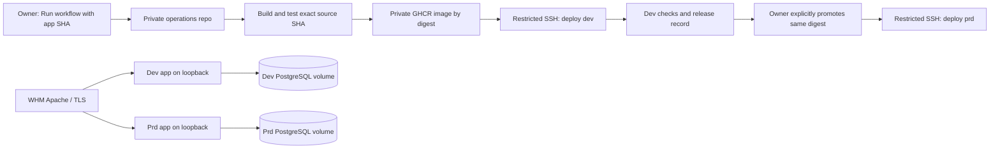

# Hosting sightreading.training on WHM

Proposal researched October 17, 2026. This PR proposes architecture and setup; it does not deploy anything, change repository visibility, or add live workflows. Hostnames, paths and account names below are proposed values, not credentials or evidence of an existing installation.

## Selected approach

**Decision update:** use manual **Run workflow** dispatch in the private operations repository for now. There is no poller, public-repo dispatcher, GitHub App or cross-repository dispatch credential. Start dev deployment manually, then manually promote a successful dev release to prd. [deploy_implementation.md](deploy_implementation.md) is the step-by-step implementation runbook. The trigger alternatives below remain background research, not work to enable initially.

## Recommendation

Keep this application fork public and create a **separate private operations repository**, for example `Naphier/sightreading-ops`. Put the production Docker build, Compose definitions, deployment workflows, server configuration templates, backup jobs and runbooks there. Use GitHub-hosted runners to build an immutable image, then deploy it over restricted SSH to the existing WHM server.

Let WHM keep control of ports 80/443, domains and certificates. Its web server reverse-proxies each hostname to a different Docker application port bound to loopback. Each stage has its own PostgreSQL container, persistent volume, session secret and deployment credential.

| Stage | Proposed URL | Compose project | Host application binding | Database storage |
| --- | --- | --- | --- | --- |
| `dev` | `https://dev-sightreading.naplandgames.com` | `sr-dev` | `127.0.0.1:18081` | `sr-dev_pgdata` |
| `prd` | `https://sightreading.naplandgames.com` | `sr-prd` | `127.0.0.1:18080` | `sr-prd_pgdata` |

The dev hostname is a suggestion; choose it before provisioning DNS. These are two stages on one server, not infrastructure redundancy: a server failure can affect both. Resource limits and separate credentials reduce accidental interference but do not provide VM-level isolation from other WHM tenants.



## GitHub privacy: what is possible

| Question | Answer |
| --- | --- |
| Can this public fork simply be made private? | **No, while it remains a fork.** A fork inherits network visibility. GitHub currently identifies this repo as a public fork of `leafo/sightreading.training`. [1] |
| Could a private application copy be created? | Yes: create a standalone private repository, or detach this fork first if GitHub offers **Leave fork network**, then change the standalone repository's visibility. The self-service detach option currently requires a public fork under 1 GB with no child forks; otherwise investigate the documented manual-copy route. Do not delete this repo to achieve this plan. [2][3] |
| Would that hide code already published? | No. Existing copies, public history and upstream code are already public. A private copy can hide future unpublished changes. Detaching also changes normal upstream PR/fork-network integration; preserve issues, PRs, branches and a recoverable mirror before a repository migration. |
| Can a workflow file in this public repo be private? | No. Committed workflow source is visible with the repository. Secrets conceal values, not the workflow's methodology; public workflow logs also need to be treated as public. |
| Can a public workflow directly `uses:` a private reusable workflow? | **No.** GitHub's accessibility matrix allows public callers to use public reusable workflows only. Secret tokens do not override this resolver restriction. [4] |
| Can deployment workflows and logs live in a private repo? | Yes. Trigger a separate run in that private repo through the API, or have it poll the app repo. This is a separate workflow run, not `workflow_call`. |
| If both repos become private, can the suggested reusable-workflow approach work? | Yes, subject to owner/organization policy and explicit Actions access settings on the called repo. Pin the called workflow to a reviewed full commit SHA. Called-workflow execution is associated with the caller, so allow caller collaborators to see relevant execution details; it is not a way to conceal operations from trusted callers. [4][5] |

**Suggested choice:** retain public upstream collaboration and keep operations private. A standalone private app copy remains an option if future application changes also need confidentiality. Check source and asset licensing before copying or redistributing: `package.json` currently says `UNLICENSED`, and no root LICENSE file was found. Publicly readable code alone does not establish an open-source license. Preserve existing credits, including icon attribution.

## Automation options

| Option | Public-repo change | Advantages | Tradeoffs |
| --- | --- | --- | --- |
| **A. Thin dispatcher → private deployment workflow** | A small workflow signals a successful trusted app commit. | Closest to the requested design; immediate dev deployment; implementation and server secrets stay private. | A dispatch credential must be available to the trusted source workflow. The private repo's name/dispatch interface is visible in that workflow. |
| **B. Private repo polls app CI / manual dispatch** | None required. | No operations credential or deployment method in the public repo. | Polling has delay; schedules are not exact and can be delayed or dropped. Add manual dispatch/reconciliation and persist the last deployed SHA. |
| **C. Both repos private + reusable workflow** | Move/detach the app first; add `workflow_call` caller. | Direct reuse matches the original idea. | Loses ordinary public-fork behavior; private Actions billing and environment features depend on the GitHub plan. |
| **D. Private self-hosted deployment runner** | Dispatcher or polling as above. | Can avoid opening inbound SSH for CI. | The runner executes deployment code on the server. Prefer a dedicated runner VM, not a public-PR runner on a shared WHM host; Docker-group access is effectively root. More maintenance than hosted runners + SSH. |

The selected initial approach is **manual dispatch only in the private repo**: neither A’s public dispatcher nor B’s polling schedule is required. A and B remain possible later if deployments become frequent. A GitHub App webhook receiver can also trigger private automation, but operating another public service is unnecessary initially. Do not use FTP: uploading files cannot safely coordinate container releases, migrations, health checks or rollback. SFTP is encrypted but still does not replace a deployment command; restricted SSH handles both control and transport.

### Alternative event flow for option A (not selected)

1. CI succeeds for a **push to protected `master`** in this repo. A small dispatcher runs only for that trusted event. With `workflow_run`, require the expected upstream workflow identity, `conclusion == success`, `event == push`, `head_branch == master`, and the expected source repository ID. Never deploy a fork PR or blindly run its artifact in a privileged follow-up job.
2. The dispatcher obtains a short-lived GitHub App installation token and calls the private repo's `dev-deploy.yml` through `workflow_dispatch`, with the full application commit SHA as its only release input. The deployment workflow exists on the private repo's default branch; dispatch it with a fixed protected operations ref such as `main`. [6]
3. The private workflow independently verifies the allowlisted source repository, exact 40-character SHA, membership in protected `master` history and successful required CI for that SHA. Do not trust payload claims, repository URLs, branch names or shell fragments. Avoid checking out a mutable branch after validation.
4. Build/test once, push a private GHCR image tagged with the source SHA, and record the immutable `sha256:` digest, source SHA and operations SHA. Deploy that digest to dev and run smoke tests. Persist a successful-dev release record in the private system; an untrusted request must not be able to forge it.
5. The owner starts a separate `promote.yml` workflow selecting that tested release. It deploys **the same digest**, without rebuilding, to `prd`. Require a successful dev record and operator authorization even if an input requests `prd`.
6. Record deployment outcomes and previous digests privately. Serialise deployments per stage with Actions concurrency plus a server-side lock; do not cancel a production migration halfway through to start a newer run.

**Important authorization boundary:** an App with Actions-write permission can dispatch other workflows in the private repo too. Therefore the dev dispatcher token is not, by itself, a dev-only privilege boundary. Make production promotion require an allowlisted human actor through manual `workflow_dispatch` (for example the owner `Naphier`), reject App/bot-triggered production runs, and enforce the successful-dev release record. Do not accept arbitrary stages or deploy commands from the public workflow. Protect the private repo's default branch and require review of changes to its workflows/scripts.

GitHub's built-in `GITHUB_TOKEN` is scoped to its repository and is not sufficient for dispatching a different private repo. Use a GitHub App installed only on the operations repo with the documented **Actions: write** permission for workflow dispatch, plus minimum metadata access; mint installation tokens in CI rather than placing a broad classic PAT in the public repo. The App private key is a longer-lived credential and still needs rotation. An expiring fine-grained PAT limited to the operations repo and Actions-write is a bootstrap alternative **only from a dedicated non-promoter identity**. Do not put an owner-issued PAT in the public dispatcher when production relies on the owner-actor check: that token could dispatch promotion as the owner and bypass the intended separation. Use the App or private polling instead if there is no separate automation identity. `repository_dispatch` is another valid API, but requires Contents-write; workflow dispatch avoids granting that broader code-write permission just to signal a run. [6][7]

The source repo should contain only the App ID/private-key requirement or dispatch-token secret needed for the chosen trigger. **SSH keys, WHM credentials, database passwords, registry-pull details and deployment scripts belong exclusively in the private operations repo/server.** Use explicit least-privilege job permissions and reviewed commit pins for third-party Actions. Never print credential-bearing requests or enable shell tracing around secrets.

### GitHub plan limitations and production approval

Private repository workflows are possible, but hosted-runner minutes/storage have plan limits. Environment secrets for private repos require a qualifying paid plan (Pro/Team/Enterprise); private-repo required reviewers and wait timers are not available on Free/Pro/Team according to the current GitHub documentation. Do not design a private Pro repo around a reviewer feature that only works in public repos on that plan. [8]

- If supported, configure `dev` and `prd` GitHub Environments, deployment-branch restrictions and required reviewers for `prd`.
- Otherwise, use separate owner-dispatched production promotion with the actor and successful-dev checks above. On a plan without private environment secrets, use distinct `DEV_...` and `PRD_...` repository secrets in the private repo. That fallback relies on trusted/reviewed workflow code; it is not an independent platform approval boundary.
- For stronger separation without an Enterprise plan, put production promotion/credentials in another owner-controlled private repo or an external approval broker. A person able to edit production workflows or secrets remains privileged.

## What this application needs in production

This is **not a static site**. The current Codespaces preview runs React/esbuild only. Account registration/login, remote trainer preferences, account hit statistics, presets and song features require Lua/Lapis/OpenResty and PostgreSQL.

Repository findings:

- `Dockerfile` runs `ci.sh`; that script installs development dependencies, initializes databases and executes tests. **Do not deploy it unchanged as the web service.** The current CI path also had LuaRocks development-rock fetch failures during testing.
- Full assets use `tup`/MoonScript and must include the generated parser, staff assets, guide JSON, and minified JS/CSS expected by `views/layout.moon` in production. Install JS with `npm ci`; don't ship the live esbuild development server as production.
- `config.moon` names database `sightreading`, but doesn't supply production host/user/password or an explicit per-stage session-signing secret. Its production port is `10007`, and it enables daemon mode. A private production image/config adapter must supply PostgreSQL connection settings and signing secrets, use that internal port (or a consistently overridden one), and run OpenResty in the foreground as the supervised container process.
- `app.moon` builds cookie attributes itself. It currently adds `HttpOnly` but not `Secure` or `SameSite`. Before launch, make a small generic application change to set appropriate production cookie flags and consume secure runtime configuration. Keep any deployment-specific templates private. Do not rely on a default Lapis development signing secret.
- Use host-only cookies, distinct stage session names/secrets, HTTPS URL generation and correctly trusted forwarded headers. Forwarded scheme/host settings must be accepted only from the local WHM proxy. HTTPS is also necessary for browser MIDI and related secure-context features.
- `migrations.moon` includes the `users.trainer_preferences` JSONB migration. Run migrations through a one-off job from the same release image against the correct stage before enabling that release.

Proposed private image: a reproducible multi-stage build with a supported pinned base, verified OpenResty/LuaJIT/Lapis/native dependencies and a Node build stage. Stable Lapis 1.20 with LuaJIT and PostgreSQL worked for the preceding backend checks, but this is evidence to start from, not a complete tested production image. Pin dependency versions/image digests, preserve TLS/checksum verification, and add full-image integration tests. Avoid the repository's mutable `:latest` CI image as the permanent production foundation.

Run the app unprivileged on its high container port, with a read-only application filesystem and explicit writable paths for temporary files/PIDs/logs. Do not mount the Docker socket into app containers. Use separate stage Compose networks, no published database ports, restart policies, health checks, resource limits and bounded log rotation. Pin a supported PostgreSQL major (17 is a reasonable initial choice) and manage major-version upgrades separately from app deployments.

## WHM server setup: administrator checklist

These steps require WHM/root-level administration; an ordinary cPanel FTP account is insufficient. Confirm the actual OS, WHM/EasyApache version and web stack before applying commands. This research session did **not** access your server. Direct retrieval of cPanel's documentation was blocked by the research environment; the EA4 include paths below are documented conventions to verify against the installed version and official references. [9][10]

### 1. Inventory and back up existing host configuration

Record Docker Engine/Compose versions, free RAM/disk, architecture, current port bindings, firewall/CSF and SELinux status. Confirm whether Apache serves requests directly or whether cPanel NGINX/another supported proxy sits in front. Check there is room for two app/DB stacks, image retention and database backups without affecting other hosted accounts. Back up the relevant WHM/vhost configuration and arrange a maintenance window for any web-server changes.

Read-only checks to run as the administrator, adapting tool names to the OS:

```bash
cat /etc/os-release
/usr/local/cpanel/cpanel -V
docker version
docker compose version
ss -lntp
free -h
df -h
```

Do not install another listener on host ports 80/443, replace WHM's Apache, disable SELinux, or globally rewrite its generated configuration to make a container work. A managed NGINX/Apache stack may need an administrator-specific proxy configuration instead of the example below.

### 2. Create DNS, cPanel domains and TLS

1. Add the production and chosen dev hostnames to the appropriate cPanel account using its Domains interface; disable shared document roots if appropriate. Keep a real document root available for domain validation.
2. Add DNS A records to the server's public IPv4 address at the authoritative DNS provider. Add AAAA records **only** if IPv6 routing, listeners and firewall are working; stale AAAA records can cause intermittent failures.
3. Issue and verify AutoSSL certificates for both hostnames before forcing HTTPS. Preserve the host's HTTP domain-control-validation paths, including any configured `/.well-known/acme-challenge/` or `/.well-known/pki-validation/` handling. Verify renewal after adding proxy rules.
4. Protect the dev hostname with Apache proxy-path authentication or an equivalent access layer. Do not assume cPanel document-root `.htaccess` privacy settings protect requests that are proxied outside that directory. Exempt the actual certificate-validation paths as needed. Add `noindex` as a courtesy, not as access control.

### 3. Provision persistent Docker storage

Keep application infrastructure outside `public_html`. A suggested layout is:

```text
/etc/sightreading/dev/           root-owned Compose/config/secret files
/etc/sightreading/prd/           separate root-owned configuration
/srv/sightreading/backups/       local backup staging; also copy off-server
/usr/local/sbin/sr-deploy-gate   root-owned SSH command validator
/usr/local/sbin/sr-apply-dev     root-owned deployment transaction
/usr/local/sbin/sr-apply-prd     separate production transaction
/etc/ssh/authorized_keys/       root-managed CI public keys
```

Create directories as root with restrictive permissions, then grant only the service access actually needed. Suggested bootstrap directory command:

```bash
install -d -m 0700 /etc/sightreading/dev /etc/sightreading/prd /srv/sightreading/backups
install -d -m 0755 /etc/ssh/authorized_keys
```

The private Compose implementation must use stable project/volume names, such as `sr-prd_pgdata`, and leave the database service in place during app-only releases. **Never run `docker compose down -v`, delete data directories or reinitialize the production cluster as a deployment step.** Containers are replaceable; named volumes and off-server backups are the data boundary.

Store independent database passwords and session-signing secrets per stage. Local Compose `secrets:` can mount protected files, but ordinary Compose does not automatically encrypt those source files. Protect the files, GitHub secrets and backup copies accordingly. Do not assume normal WHM/cPanel account backups include Docker volumes.

### 4. Add the per-domain reverse proxy

With standard EasyApache 4, use supported **per-domain userdata include files**, rather than editing generated `httpd.conf`. Typical HTTPS include path:

```text
/etc/apache2/conf.d/userdata/ssl/2_4/CPANEL_USER/sightreading.naplandgames.com/proxy.conf
```

Use a separate include for the dev hostname. HTTP includes normally use `std` in place of `ssl`; preserve validation and redirect normal HTTP traffic to HTTPS there. Replace `CPANEL_USER` with the actual cPanel account owner, not the CI deployment user. [9]

Illustrative production **HTTPS-vhost** proxy fragment, to review against the live stack:

```apache
ProxyRequests Off
ProxyPreserveHost On
# Retain the installed AutoSSL/DCV handlers before the catch-all proxy.
ProxyPass "/.well-known/acme-challenge/" "!"
ProxyPass "/.well-known/pki-validation/" "!"
RequestHeader unset Forwarded
RequestHeader set X-Forwarded-Proto "https"
RequestHeader set X-Forwarded-Host "sightreading.naplandgames.com"
ProxyPass "/" "http://127.0.0.1:18080/" retry=0 timeout=60
ProxyPassReverse "/" "http://127.0.0.1:18080/"
```

Confirm `mod_proxy`, `mod_proxy_http` and `mod_headers` are enabled through EasyApache. Rebuild the configuration through cPanel's supported scripts (commonly `/usr/local/cpanel/scripts/rebuildhttpdconf`), validate with the installed Apache config-test command, then perform a supported graceful restart. Activate/ensure userdata includes if required by that version. Keep your existing administrator session open and verify unrelated sites. Do not run an unvalidated global restart.

For dev, change both the hostname and port to `18081` and apply the access restriction. Ensure the app's cross-origin isolation headers in `nginx.conf` survive the proxy; verify MIDI/audio behavior, cookies, CSRF and redirects through the real HTTPS URL.

Publish Docker application ports explicitly on `127.0.0.1`, not `0.0.0.0`. Publish no PostgreSQL ports. Confirm externally that 18080, 18081 and 5432 are unreachable, including over IPv6. Docker's forwarding/firewall behavior can bypass simplistic host firewall assumptions; Docker versions before 28 also have a documented same-L2 limitation for localhost publishing. Review/update the actual engine and firewall rather than assuming loopback alone proves isolation. [11]

### 5. Create restricted, expiring deployment access

Use **SSH, not root FTP**. Create separate non-password CI identities for dev and prd, for example `sr-dev-ci` and `sr-prd-ci`, with no unrestricted sudo and **no membership in the Docker group**. Docker-group membership would grant much more than application deployment access.

Generate a separate temporary Ed25519 key for each stage on a trusted administrator machine, not in this public repo:

```bash
ssh-keygen -t ed25519 -a 64 -f sr-dev-ci -C sightreading-dev-ci -N ''
ssh-keygen -t ed25519 -a 64 -f sr-prd-ci -C sightreading-prd-ci -N ''
```

Keep private files mode 0600 and enter them securely in GitHub Secrets. Install only public keys on the server. Keep administrator bootstrap access separate and revoke it after setup. An ordinary SSH key **does not expire automatically**, and GitHub Secrets do not make it temporary by themselves.

For actual server-enforced expiration, use supported OpenSSH `expiry-time` options or short-lived SSH certificates. Example authorized-key prefix, with placeholders deliberately requiring replacement:

```text
restrict,command="/usr/local/sbin/sr-deploy-gate dev",expiry-time="YYYYMMDDHHMMSSZ" ssh-ed25519 PUBLIC_KEY_DATA dev-ci
```

Use a separate `prd` command and expiry for the production key. The `Z` suffix means UTC; choose a short validity window and schedule rotation/revocation. Verify the server's OpenSSH supports the selected options and test both accepted and rejected commands. If it lacks them, use SSH certificates with validity periods or an explicit administrator revocation job; don't silently describe an unlimited key as temporary. [12]

Use a root-managed `AuthorizedKeysFile` path under `/etc/ssh/authorized_keys/` for these identities via carefully scoped `Match User` rules. Do not allow the CI account to replace its own command restrictions. Keep password authentication disabled for these accounts, prohibit forwarding/PTY, and run `sshd -t` before reloading SSH. Preserve existing WHM/administrator SSH access.

A proposed SSH policy fragment, placed through the server's supported configuration mechanism, is:

```text
Match User sr-dev-ci,sr-prd-ci
    AuthorizedKeysFile /etc/ssh/authorized_keys/%u
    AuthenticationMethods publickey
    PasswordAuthentication no
    KbdInteractiveAuthentication no
    AllowAgentForwarding no
    AllowTcpForwarding no
    X11Forwarding no
    PermitTTY no
Match all
```

Create each root-managed **public** authorized-key file root-owned mode 0644 under the non-user-writable directory, then install its stage-specific restricted public-key line. It must be readable when sshd checks it as the target account; a root-owned mode-0600 file there can prevent key authentication. Private key files remain mode 0600. Verify any SELinux file context required by the centralized path. Verify the daemon's account/password-lock policy still permits public-key authentication for the dedicated identities. Before ending bootstrap access, test a valid deployment request and confirm an attempted interactive shell, SFTP session and cross-stage request are rejected.

A minimal proposed sudoers fragment uses **no command arguments**; the helper reads its strictly validated protocol from stdin:

```text
sr-dev-ci ALL=(root) NOPASSWD: /usr/local/sbin/sr-apply-dev ""
sr-prd-ci ALL=(root) NOPASSWD: /usr/local/sbin/sr-apply-prd ""
```

Install it root-owned mode 0440 through `visudo`, and validate it with `visudo -cf` before use. The quoted empty argument list is intentional: allowing a bare command path in sudoers can permit arbitrary arguments. This rule is safe only once the fixed helpers and their input-validation/release checks exist; it must not grant access to a general shell, `docker`, `docker compose`, editors or writable scripts.

The **private operations repo must implement and review the gate before any key is authorized**:

- Parse a tiny allowlisted request such as `deploy sha256:<64 lowercase hex characters>`. Reject other commands, stages, paths, tags, shell fragments and extra parameters. Do not use `eval` or interpolate untrusted inputs into a remote shell.
- The stage is fixed by the authorized key, not selected by the caller. Use a narrowly scoped sudo rule to invoke only that stage's root-owned helper, with the helper independently validating its input. Keep Compose files, entrypoints and helpers root-owned and unwritable by the SSH identity.
- The helper uses a fixed allowlisted registry/image name and approved release metadata. It cannot accept arbitrary Compose files, mounts, repository URLs or Docker commands. A deployment key must not become a general way to launch privileged containers on the WHM server.
- Supply any registry token through encrypted SSH stdin, never a command-line argument or logs. Prefer the private workflow job's short-lived `GITHUB_TOKEN` with `packages: read` and explicit access to the private GHCR package. Use an isolated temporary Docker credential directory for the pull and remove it afterward; do not leave a repository-wide token on the server. Existing locally pulled images can restart after reboot without a fresh registry login. A later pull/rollback workflow obtains a fresh token.
- Lock the stage, pull the immutable digest, verify release metadata, take the required backup, run migrations once, replace only the app service, check health and either record success or perform the documented rollback. Bound execution time and preserve logs without secrets.

Pin the server's SSH host key in a `known_hosts` secret/config obtained and fingerprint-verified through a trusted admin/WHM console. Use strict host-key checking. Do not use `StrictHostKeyChecking=no` or trust an unauthenticated `ssh-keyscan` result gathered during the deployment itself.

Hosted-runner outbound IPs are not one small stable IP to whitelist. Use a supported fixed-egress runner option, an authenticated tunnel, or expose a hardened existing SSH service with key-only restricted identities under the administrator's firewall policy. Do not open all server management ports or invent a GitHub-wide firewall rule. Where fixed egress exists, also restrict the key's `from=` addresses.

For fully automatic short-lived credentials later, an OIDC-aware SSH certificate issuer/broker can exchange GitHub job identity for a short-validity certificate. This needs a trust service and policy; plain WHM/SSH does not automatically accept GitHub OIDC tokens. Start with explicitly expiring keys and make expiry failures visible rather than adding that service on day one.

## GitHub configuration and credential inventory

Create the private operations repo and enable Actions only for trusted deployment code. It should own the private GHCR package. Grant its build job `packages: write` and its deploy jobs only `packages: read`, plus the minimum repository/API permissions each job needs. Set the package visibility/access explicitly; a private repo alone does not substitute for checking package settings.

| Location | Requirements | Notes |
| --- | --- | --- |
| Public app repo, if option A | Dispatch App ID + private key, or expiring limited dispatch token | Only the trusted post-CI dispatcher receives it. No SSH/database/WHM secrets here. |
| Private repo, `dev` environment or `DEV_` secrets | SSH host/port/user, temporary dev private key, verified SSH host-key material | Stage-specific key; hostname/user are configuration, key is secret. |
| Private repo, `prd` environment or `PRD_` secrets | Separate production SSH connection/key/host-key material | Only the authorized production promotion job receives these. |
| Server's protected per-stage files | DB password, app session-signing secret and any required runtime configuration | Generate independently, persist across app restarts, and back up securely. WHM root credentials are not routine CI credentials. |
| GitHub-provided job credential | `GITHUB_TOKEN` with explicit GHCR package access | Short-lived per workflow job; use only for the relevant build/pull, not as a cross-repository dispatch credential. |

Document each temporary key/token's issuer, authorized scope, expiry, rotation owner and revocation procedure privately. Expiration should fail a deployment clearly; it must not trigger a fallback to password/root access.

## Release, data and recovery procedure

1. **Prepare:** stabilize CI before tying deployments to it; implement the production image, environment adapter, secure cookies, private release validation and restricted server helpers. Ensure readiness checks exercise the actual backend rather than only a PID or open port. Bootstrap a fresh database through migrations (or a reviewed restore), not `ci.sh` or test fixtures.
2. **Dev:** manually dispatch deployment of a validated `master` SHA; verify HTTPS, registration/login/logout, CSRF rejection, settings restore across separate authenticated browsers, hit uploads, Stats and the song routes. Check keyboard/MIDI in a secure browser context. Confirm a container restart retains account settings and statistics.
3. **Promote:** the authorized owner selects the successful dev image digest. Before migrations, take and verify a production backup. Prefer additive/backward-compatible schema changes. For a breaking migration, require an explicit maintenance plan; do not promise zero-downtime rollback.
4. **Deploy:** run one migration job with a stage-level lock, then start the new app against the existing DB. A simple single-app replacement may cause a brief interruption; initial simplicity is preferable to claiming zero downtime. Use blue/green app instances and a proxy switch later if interruption becomes unacceptable.
5. **Check:** validate internal readiness and the external HTTPS hostname, preserving cookies/CSRF flow. Failed health checks stop promotion. Save the release SHA/digest, migration result, previous release, timestamps and backup identifier privately.
6. **Rollback:** restore the previous app digest if compatible with the migrated schema. Do not blindly run down-migrations. If a DB restore is required, stop writes and document the recovery point: restoring an earlier backup can lose intervening account activity.
7. **Back up continuously:** schedule PostgreSQL-consistent dumps, keep encrypted off-server copies, and monitor backup age/failures. A starting policy is nightly dumps retained 7 daily/4 weekly/3 monthly, plus pre-migration backups; agree actual recovery objectives. Perform a restore drill into an isolated database and test account login/settings/Stats. A Docker volume or local snapshot alone is not a backup.
8. **Operate:** restart containers after host reboot through Docker/systemd policy; monitor external HTTPS and DB/app health, disk growth, certificates and key expiry. Keep a bounded set of prior image digests and avoid automated volume pruning. PostgreSQL major upgrades require their own dump/restore or supported upgrade plan.

A new hostname/server does not inherit the old maintainer's users, songs or statistics. Ask for an authorized PostgreSQL export and any required signing/configuration material if retaining that data is intended; do not assume access. Restore and test privately before cutover. If no export is available, launch a fresh database and tell users they must register again. Browser localStorage is origin-specific and also will not automatically move from the original site or Codespaces URL.

## Implementation sequence and acceptance criteria

This proposal adds documentation only: this plan and the manual-deployment implementation runbook. Follow-up implementation should be split into reviewable changes:

1. Confirm WHM OS/web stack, root access, DNS authority, available resources, GitHub plan, preferred dev hostname, and whether data migration from the original host is required. Use the selected private-repo manual-dispatch approach; no trigger credential or polling schedule is needed.
2. Make generic application configuration/cookie improvements here. Build and test the production image and Compose setup in the private repo; fix the CI prerequisite rather than skipping failed tests.
3. Provision DNS/TLS, persistent volumes, backups and the private dev stack. Install the reviewed SSH gate/helpers and verified host keys. Issue temporary dev access and store it securely.
4. Automate dev, test credential expiry/denials, and demonstrate persistence across container replacement and reboot. Verify dev data cannot access production and public network probes cannot reach app/DB ports.
5. Provision `prd`, complete a backup/restore and failed-release rollback drill, then enable owner-controlled promotion of a digest already tested on dev. Revoke bootstrap access and record rotation ownership.

The first production release is ready only when the live HTTPS checks, persistent-data checks, restore drill, stage isolation, credential expiration/revocation and rollback procedure all work on the actual server. Existing local/browser/API tests provide application evidence, not proof this WHM deployment is ready.

## Sources and research boundaries

GitHub restrictions, API shapes and Docker/OpenSSH details were checked against their official documentation source repositories through the GitHub API. Direct web-document fetches, including cPanel's site, were blocked in this environment. The official cPanel references are included for administrator verification; no claim is made that the live WHM configuration or these example proxy commands were tested. The application findings above come from this repository, not inspection of the original maintainer's server.

1. [GitHub: fork visibility](https://docs.github.com/en/pull-requests/reference/forks#visibility-of-forks) — [official source](https://github.com/github/docs/blob/main/content/pull-requests/reference/forks.md).
2. [GitHub: detaching a fork](https://docs.github.com/en/pull-requests/how-tos/work-with-forks/detaching-a-fork) — includes eligibility for Leave fork network and the manual alternative.
3. [GitHub: repository visibility](https://docs.github.com/en/repositories/managing-your-repositorys-settings-and-features/managing-repository-settings/setting-repository-visibility).
4. [GitHub: reusable-workflow access matrix](https://docs.github.com/en/actions/reference/workflows-and-actions/reusing-workflow-configurations#access-to-reusable-workflows) — [official source](https://github.com/github/docs/blob/main/content/actions/reference/workflows-and-actions/reusing-workflow-configurations.md).
5. [GitHub: sharing across private repositories](https://docs.github.com/en/actions/how-tos/reuse-automations/share-across-private-repositories) and [organization sharing](https://docs.github.com/en/actions/how-tos/reuse-automations/share-with-your-organization).
6. [GitHub REST: workflow dispatch and permissions](https://docs.github.com/en/rest/actions/workflows#create-a-workflow-dispatch-event) — request contract checked in [official OpenAPI source](https://github.com/github/rest-api-description/blob/main/descriptions/api.github.com/api.github.com.json).
7. [GitHub REST: repository dispatch](https://docs.github.com/en/rest/repos/repos#create-a-repository-dispatch-event).
8. [GitHub: environment features and plan limitations](https://docs.github.com/en/actions/reference/workflows-and-actions/deployments-and-environments) — required-reviewer, wait-timer and private environment-secret restrictions.
9. [cPanel: modify Apache virtual hosts with include files](https://docs.cpanel.net/ea4/apache/modify-apache-virtual-hosts-with-include-files/).
10. [cPanel: Domains interface](https://docs.cpanel.net/cpanel/domains/domains/) and [WHM AutoSSL](https://docs.cpanel.net/whm/ssl-tls/manage-autossl/).
11. [Docker: port publishing and localhost limitations](https://docs.docker.com/engine/network/port-publishing/) — [official source](https://github.com/docker/docs/blob/main/content/manuals/engine/network/port-publishing.md).
12. [OpenSSH: authorized_keys restrictions and expiry](https://man.openbsd.org/sshd.8#AUTHORIZED_KEYS_FILE_FORMAT) — `restrict`, `command` and `expiry-time` checked in [official portable source](https://github.com/openssh/openssh-portable/blob/master/sshd.8).
